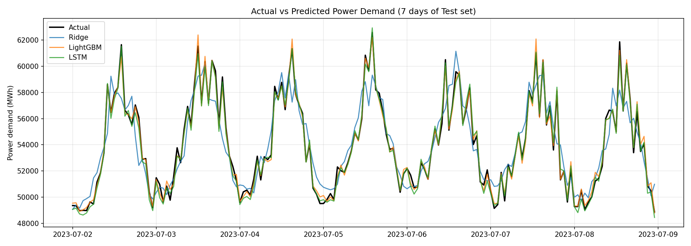
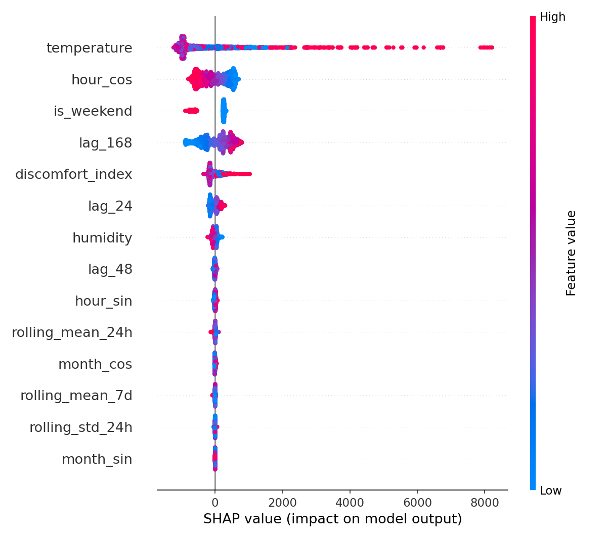

#  기상 및 캘린더 데이터를 활용한 시간별 전력 수요량 예측 회귀 모델

> **과거 24시간 이전 데이터 및 기상 예보 데이터를 기반으로 향후 24시간 전력 수요량(MWh)을 예측하는 End-to-End 시계열 회귀 프로젝트**

---

##  1. 프로젝트 개요

* **목표**: 일간/계절 주기성과 기온의 비선형적 관계를 반영하여 24시간 뒤의 전력 수요량을 정밀 예측 (회귀 문제)
* **주요 해결 과제**:
  * 시계열 정형 데이터 기반 고도화된 특징 설계 (Feature Engineering)
  * 다중 스텝 시계열 예측 시 필연적으로 발생하는 **데이터 누수(Data Leakage) 원천 차단**
  * `Scikit-learn`, `LightGBM`, `PyTorch(LSTM)` 3개 모델 벤치마크 및 비즈니스 관점 오차 평가
  * **SHAP**을 활용한 모델 해석
* **기술 스택**: Python, Pandas, Scikit-learn, LightGBM, PyTorch, Matplotlib, SHAP

---

##  2. 핵심 결과 요약

Test 셋(2023년, 8,737건) 기준 성능임. Test 셋은 학습/Early Stopping에 일절 사용하지 않음.

| Model | MAE (MWh) | RMSE (MWh) | MAPE (%) |
|-------|-----------|------------|----------|
| Ridge (Baseline) | 684.38 | 981.39 | 1.30 |
| **LightGBM** | **259.36** | **328.94** | **0.50** |
| PyTorch-LSTM | 272.34 | 345.02 | 0.53 |

* LightGBM이 가장 낮은 오차를 기록했고, LSTM이 근소한 차이로 뒤를 이음. Ridge 대비 LightGBM의 MAE는 **약 62% 감소**함.
* 선형 모델인 Ridge는 기온-수요의 **U자형 비선형 관계**를 잡지 못해 오차가 큼 (아래 그래프에서 피크/저점 구간 이탈 확인 가능).
* 데이터 생성 시 수요에 주입한 노이즈가 표준편차 300 MWh라서, 이론적으로 줄일 수 없는 오차는 MAE ≈ 240, RMSE ≈ 300 수준임. LightGBM(MAE 259, RMSE 329)과 LSTM은 이 하한에 근접해 있음.
* LightGBM과 LSTM의 차이(MAE 약 13 MWh)는 단일 시드 실험 결과라서 우열을 단정하기는 어려움.

---

##  3. 프로젝트 구조

```
.
├── main.py                  # 전체 파이프라인 실행 진입점
├── requirements.txt
├── outputs/                 # 실행 시 생성되는 시각화 결과
│   ├── predictions.png
│   └── shap_summary.png
└── src/
    ├── data_generator.py    # 기상 + 전력 수요 시계열 데이터 생성
    ├── features.py          # 누수 방지 특징 엔지니어링
    ├── models_tree.py       # Ridge(Baseline), LightGBM
    ├── models_pytorch.py    # PyTorch LSTM 모델 및 학습/추론
    ├── evaluate.py          # MAE / RMSE / MAPE 산출
    └── visualize.py         # 예측 그래프, SHAP summary plot
```

---

##  4. 파이프라인

| 단계 | 내용 |
|------|------|
| 1. 데이터 생성 | 2021-01-01 ~ 2023-12-31 시간 단위 데이터 (26,257 샘플, 약 1,094일) |
| 2. 특징 엔지니어링 | 순환 인코딩, 불쾌지수, Lag, Rolling 통계량 생성 (전부 t-24 이전 데이터만 사용) |
| 3. 시계열 3분할 | 시간축 기준 Train / Val / Test 절대 분할 |
| 4. 모델 학습 | Ridge → LightGBM → PyTorch LSTM |
| 5. 평가 | Test 셋에서 MAE, RMSE, MAPE 벤치마크 |
| 6. 해석 | LightGBM Feature Importance(Gain) + SHAP summary plot |

### 데이터 분할

| 구분 | 기간 | 샘플 수 | 용도 |
|------|------|---------|------|
| Train | 2021-01-08 ~ 2022-06-30 | 12,913 | 모델 학습 |
| Val | 2022-07-01 ~ 2022-12-31 | 4,416 | Early Stopping (LightGBM, LSTM) |
| Test | 2023-01-01 ~ 2023-12-31 | 8,737 | **최종 성능 보고 전용** |

* 앞쪽 7일은 Lag/Rolling 계산용 결측치라 제거됨.
* Test를 1개 연도 전체로 잡아서 사계절 성능을 모두 평가함.

---

##  5. 데이터

실제 전력 수요 및 기상 관측 패턴을 모사한 **합성 데이터**를 사용함 (`np.random.seed(42)` 고정으로 재현 가능).

* **기온**: 연간 계절성(여름 ≈ 30℃, 겨울 ≈ 0℃) + 일교차 + 가우시안 노이즈
* **습도**: 일주기 패턴 + 노이즈 (10~100% 클리핑)
* **전력 수요**: 기저부하(50,000 MWh) + 기온과의 **비선형 U자형 관계** + 일간 주기 + 주말 감소 효과 + 노이즈(σ=300)
  * 22℃ 초과 시 냉방 수요 급증, 12℃ 미만 시 난방 수요 급증, 그 사이 구간은 최저

---

##  6. 특징 엔지니어링 및 데이터 누수 방지

24시간 뒤를 예측하는 문제라서, 예측 시점 t에서 **실제로 알 수 있는 정보만** 입력으로 사용하도록 설계함.

### 6-1. 특징 목록 (총 14개)

| 분류 | 변수 | 설명 |
|------|------|------|
| 기상 | `temperature`, `humidity` | 기상 예보값으로 가정 |
| 캘린더 | `hour_sin/cos`, `month_sin/cos`, `is_weekend` | 삼각함수 순환 인코딩으로 23시↔0시, 12월↔1월 연속성 보존 |
| 도메인 | `discomfort_index` | 기온·습도 기반 불쾌지수(DI) |
| Lag | `lag_24`, `lag_48`, `lag_168` | 어제 동시간 / 이틀 전 / 지난주 동시간 수요 |
| Rolling | `rolling_mean_24h`, `rolling_std_24h`, `rolling_mean_7d` | 최근 24시간 / 7일 통계량 |

### 6-2. 누수 차단 장치

* **Lag**: 최소 `horizon(24h)` 이상 이전 값만 참조
* **Rolling**: `shift(horizon)`을 **먼저** 적용한 뒤 rolling 계산 → 미래 값 침범 차단
* **분할**: 랜덤 분할이 아닌 시간축 기준 Temporal Split, Val/Test 분리로 평가 오염 방지
* **전처리**: Scaler는 Train 셋에만 `fit` 후 Val/Test에 `transform` (Ridge는 `Pipeline`으로 캡슐화)

---

##  7. 모델

| 모델 | 역할 | 핵심 설정 |
|------|------|-----------|
| **Ridge Regression** | 선형 Baseline | `StandardScaler` + `Ridge(alpha=1.0)` Pipeline |
| **LightGBM** | 정형 시계열 GBDT | `n_estimators=1000`, `lr=0.03`, `num_leaves=31`, subsample/colsample 0.8, Early Stopping(30 rounds, best iteration 504) |
| **PyTorch LSTM** | 시퀀스 딥러닝 | 2-layer LSTM(hidden 64, dropout 0.2) + FC head, 입력 시퀀스 길이 24, Adam(lr=0.003), Gradient Clipping(1.0), Early Stopping(patience 5) |

### LSTM 구현 시 신경 쓴 점

* 윈도우의 **마지막 행이 타깃 시점 t와 일치**하도록 정렬 (t 시점 기상 예보 피처 포함)
* 타깃(y)도 Train 기준으로 스케일링 후 예측 시 MWh로 복원 → 수렴 안정화
* Val loss 기준 최적 가중치를 `deepcopy`로 보관하여 복원
* Test 첫 구간은 Val 마지막 구간을 context로 붙여 예측 → **다른 모델과 동일한 y로 공정 비교**

---

##  8. 평가 지표

비즈니스 관점에서 해석 가능한 3개 지표 사용함.

* **MAE (MWh)**: 평균적으로 몇 MWh 틀리는지
* **RMSE (MWh)**: 큰 오차에 더 큰 페널티 (피크 수요 예측 실패에 민감)
* **MAPE (%)**: 수요 규모 대비 오차 비율

---

## 📈 9. 결과 분석

### 9-1. 예측 vs 실제 (Test 셋 7일 구간)



* LightGBM, LSTM은 일간 피크와 저점을 거의 그대로 따라감.
* Ridge는 피크 높이와 저점 위치에서 반복적으로 벗어남. 기온-수요의 비선형 관계를 표현하지 못하기 때문임.

### 9-2. SHAP 변수 해석 (LightGBM)



* **`temperature`**: 영향력이 압도적으로 큼. 고온 구간에서 SHAP 값이 크게 양(+)으로 치우치며 최대 약 +8,000 MWh까지 올라감 → 냉방 수요 급증이라는 데이터 생성 구조를 모델이 학습했음을 확인함.
* **`is_weekend`**: 주말이면 일관되게 수요를 낮추는 방향(약 -800 ~ -1,000 MWh)으로 작용함.
* **`hour_cos`**: 시간대(일간 주기)에 따른 수요 변동을 설명함.
* **`lag_168`**: 지난주 동시간 수요가 높을수록 예측이 올라감 → 주간 패턴 반영.
* **`discomfort_index`**: 기온과 겹치는 정보가 있지만 고온 구간에서 추가로 양(+)의 기여를 함.
* `rolling_*`, `month_*`, `lag_48` 등은 영향이 작음 → 후속 실험에서 피처 축소 후보임.
* Gain 기준 중요도 Top 5는 `temperature > lag_168 > discomfort_index > lag_24 > hour_cos` 순이었고, SHAP에서는 `hour_cos`, `is_weekend`의 기여가 더 크게 나타남. 지표 정의 차이에 따른 것임.

---

##  10. 실행 방법

```bash
# 1. 의존성 설치
pip install -r requirements.txt

# 2. 전체 파이프라인 실행
python main.py
```

* 데이터 생성 → 특징 생성 → 3개 모델 학습 → 성능 비교표 → Feature Importance → 시각화 저장(`outputs/`) 순으로 자동 수행됨

---

##  11. 한계 및 향후 개선 방향

* **합성 데이터 기반**이라 성능 수치가 실제 환경을 그대로 반영하지 않음. 노이즈 하한에 근접한 결과이므로 실제 전력 데이터(공휴일, 특수일, 산업 부하, 예보 오차 등)에서 재검증이 필요함.
* 기상 변수를 예측 시점의 **실측 대용 값(완벽한 예보)**으로 가정함. 실제로는 예보 오차가 추가됨.
* 단일 시드/단일 분할 결과라서 모델 간 근소한 차이는 반복 실험(다중 시드, Rolling-origin CV)으로 검증 필요함.
* 단일 시점(t+24) 예측 구조라 향후 24시간 전체를 예측하는 Multi-step 확장 가능.
* 공휴일 변수 추가, Optuna 하이퍼파라미터 튜닝, 영향 낮은 피처 제거 실험 예정.
