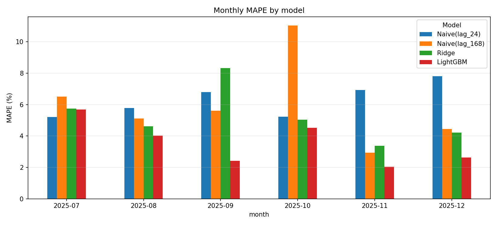
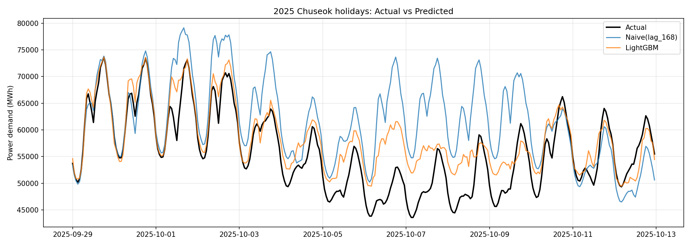
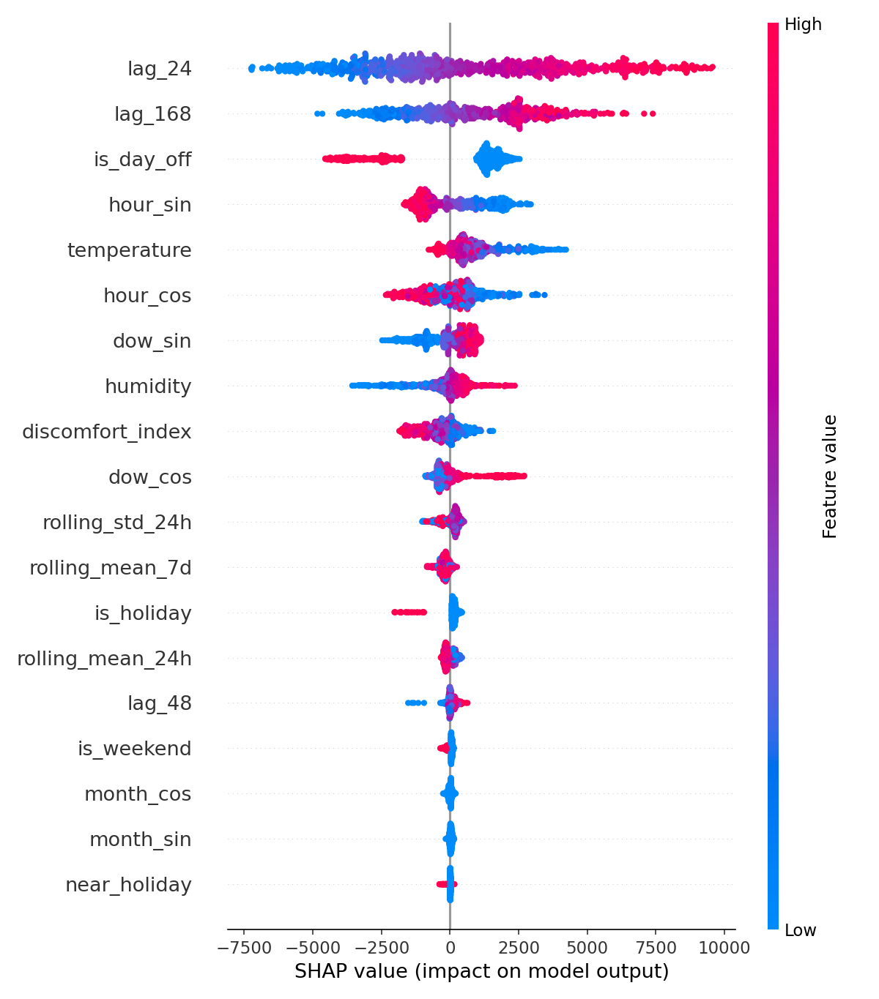

#  기상 및 캘린더 데이터를 활용한 시간별 전력 수요량 예측 회귀 모델

> **과거 24시간 이전 데이터 및 기상 예보 데이터를 기반으로 향후 24시간 전력 수요량(MWh)을 예측하는 End-to-End 시계열 회귀 프로젝트**
> 합성 데이터로 파이프라인과 누수 방지를 검증하고, **한국전력거래소(KPX) 실제 데이터**로 재검증함.

---

##  1. 프로젝트 개요

* **목표**: 일간/계절 주기성과 기온의 비선형적 관계를 반영하여 24시간 뒤의 전력 수요량을 정밀 예측 (회귀 문제)
* **주요 해결 과제**:
  * 시계열 정형 데이터 기반 고도화된 특징 설계 (Feature Engineering)
  * 다중 스텝 시계열 예측 시 필연적으로 발생하는 **데이터 누수(Data Leakage) 원천 차단**
  * `Scikit-learn`, `LightGBM`, `PyTorch(LSTM)` 모델 벤치마크 및 비즈니스 관점 오차 평가
  * 공휴일·연휴 등 **실제 데이터 특유의 패턴** 반영과 **SHAP** 기반 모델 해석
* **기술 스택**: Python, Pandas, Scikit-learn, LightGBM, PyTorch, Matplotlib, SHAP
* **2단계 검증 구조**
  * **Part A (합성 데이터)**: 의도한 패턴(기온 U자형 관계, 주기성)을 모델이 학습하는지, 파이프라인이 누수 없이 동작하는지 확인
  * **Part B (실제 KPX 데이터)**: 실제 환경에서의 성능과 약점을 Rolling-origin 검증으로 확인

---

##  2. 핵심 결과 요약

### Part B. 실제 데이터 (KPX 2025, Test 2025-07 ~ 12, 4,416건)

| Model | MAE (MWh) | RMSE (MWh) | MAPE (%) |
|-------|-----------|------------|----------|
| Naive (어제 같은 시간) | 4,141.13 | 6,249.36 | 6.28 |
| Naive (지난주 같은 시간) | 3,922.00 | 5,519.37 | 5.96 |
| Ridge | 3,441.24 | 4,434.82 | 5.21 |
| **LightGBM** | **2,442.81** | **3,585.58** | **3.57** |

* LightGBM은 가장 강한 단순 baseline(지난주 같은 시간) 대비 **MAE 약 38%, MAPE 5.96% → 3.57%** 개선함.
* 기상 변수를 넣으면 LightGBM MAE가 2,961.83 → 2,442.81로 **약 17.5% 감소**함 (자세한 비교는 6-3 참고).
* 공휴일(MAPE 8.89%)과 7월(여름, 학습 구간에 여름 데이터 없음)은 여전히 약점임 (6-4 참고).

### Part A. 합성 데이터 (Test 2023년, 8,737건)

| Model | MAE (MWh) | RMSE (MWh) | MAPE (%) |
|-------|-----------|------------|----------|
| Ridge (Baseline) | 684.38 | 981.39 | 1.30 |
| **LightGBM** | **259.36** | **328.94** | **0.50** |
| PyTorch-LSTM | 272.34 | 345.02 | 0.53 |

* 합성 데이터에서 MAPE 0.5%가 나온 건 수요에 주입한 노이즈(σ=300 MWh)의 이론적 하한(MAE ≈ 240, RMSE ≈ 300)에 근접했기 때문임. **실제 성능 지표는 Part B임.**

---

##  3. 프로젝트 구조

```
.
├── main.py                  # Part A: 합성 데이터 파이프라인
├── main_real.py             # Part B: 실제 KPX 데이터 Rolling-origin 검증
├── fetch_weather.py         # 시간별 기상 데이터 다운로드 (Open-Meteo)
├── requirements.txt
├── data/                    # 원본 데이터 (저장소에 포함하지 않음)
├── outputs/                 # Part A 시각화 결과
├── outputs_real/            # Part B 결과 (지표 CSV, 그래프)
└── src/
    ├── data_generator.py    # 합성 기상 + 전력 수요 시계열 생성
    ├── data_loader.py       # KPX 수요 CSV / 기상 CSV 로더
    ├── features.py          # 합성 데이터용 누수 방지 특징 엔지니어링
    ├── features_real.py     # 실제 데이터용 특징 (공휴일/연휴 포함)
    ├── models_tree.py       # Ridge(Baseline), LightGBM
    ├── models_pytorch.py    # PyTorch LSTM 모델 및 학습/추론
    ├── evaluate.py          # MAE / RMSE / MAPE 산출
    └── visualize.py         # 예측 그래프, 월별 MAPE, SHAP summary
```

---

##  4. 특징 엔지니어링 및 데이터 누수 방지

24시간 뒤를 예측하는 문제라서, 예측 시점 t에서 **실제로 알 수 있는 정보만** 입력으로 사용하도록 설계함.

### 4-1. 특징 목록

| 분류 | 변수 | 설명 |
|------|------|------|
| 기상 | `temperature`, `humidity` | 기상 예보값으로 가정 |
| 캘린더 | `hour_sin/cos`, `month_sin/cos`, `is_weekend` | 삼각함수 순환 인코딩으로 23시↔0시, 12월↔1월 연속성 보존 |
| 캘린더 (실데이터) | `dow_sin/cos` | 요일 순환 인코딩 |
| 공휴일 (실데이터) | `is_holiday`, `is_day_off`, `near_holiday` | 공휴일(임시·대체 포함) / 공휴일·주말 / 공휴일 포함 연휴 직전·직후 평일(징검다리) |
| 도메인 | `discomfort_index` | 기온·습도 기반 불쾌지수(DI) |
| Lag | `lag_24`, `lag_48`, `lag_168` | 어제 동시간 / 이틀 전 / 지난주 동시간 수요 |
| Rolling | `rolling_mean_24h`, `rolling_std_24h`, `rolling_mean_7d` | 최근 24시간 / 7일 통계량 |

### 4-2. 누수 차단 장치

* **Lag**: 최소 `horizon(24h)` 이상 이전 값만 참조
* **Rolling**: `shift(horizon)`을 **먼저** 적용한 뒤 rolling 계산 → 미래 값 침범 차단
* **분할**: 랜덤 분할이 아닌 시간축 기준 분할. Early Stopping용 Val과 최종 평가용 Test를 분리
* **전처리**: Scaler는 Train 셋에만 `fit` 후 Val/Test에 `transform` (Ridge는 `Pipeline`으로 캡슐화)
* **실데이터 Rolling-origin**: 각 Test 월 이전의 데이터만 학습에 사용 (미래 월 정보 사용 없음)

---

##  5. 모델

| 모델 | 역할 | 핵심 설정 |
|------|------|-----------|
| **Naive (lag_24 / lag_168)** | 단순 기준선 | 어제 / 지난주 같은 시간 값을 그대로 예측값으로 사용 |
| **Ridge Regression** | 선형 Baseline | `StandardScaler` + `Ridge(alpha=1.0)` Pipeline |
| **LightGBM** | 정형 시계열 GBDT | `n_estimators=1000`, `lr=0.03`, `num_leaves=31`, subsample/colsample 0.8, Early Stopping(30 rounds) |
| **PyTorch LSTM** (Part A) | 시퀀스 딥러닝 | 2-layer LSTM(hidden 64, dropout 0.2) + FC head, 시퀀스 길이 24, Adam(lr=0.003), Gradient Clipping, Early Stopping(patience 5) |

**LSTM 구현 시 신경 쓴 점**: 윈도우 마지막 행이 타깃 시점 t와 일치하도록 정렬 / 타깃(y)도 Train 기준 스케일링 후 MWh로 복원 / 최적 가중치를 `deepcopy`로 보관 / Val 마지막 구간을 context로 붙여 Test 전체를 다른 모델과 동일한 y로 공정 비교

---

##  6. Part B. 실제 데이터 검증 (KPX)

### 6-1. 데이터

* **전력 수요**: 한국전력거래소 「시간별 전국 전력수요량」 (공공데이터포털). 2025-01-01 ~ 2025-12-31, 8,760시간, 결측 없음. 시간 단위 전국 발전단 수요이며 수요예측용 잠정자료임.
* **기상**: Open-Meteo 과거 기상 API로 받은 6개 대도시(서울·인천·대전·대구·광주·부산) 시간별 기온/습도의 단순 평균 (`fetch_weather.py`). **ASOS 실측이 아닌 재분석 기반 값**임.
* 'N시' 열은 시간 종료 기준으로 보고 N-1시로 매핑함 (1시→00:00, 24시→23:00).
* 원본 데이터는 용량·이용조건 문제로 저장소에 포함하지 않음. 공공데이터포털에서 직접 내려받아 `data/`에 두면 됨.

### 6-2. 검증 방식: 월 단위 Rolling-origin (Expanding Window)

데이터가 1년치라서 연 단위 분할이 불가능함. 그래서 **7월~12월을 매달 Test로 두고 그 이전 전체를 Train으로** 학습하는 방식을 사용함. Train 끝 28일은 LightGBM Early Stopping용 Val로 씀.

| Test 월 | Train 건수 | Test 건수 |
|---------|-----------|-----------|
| 2025-07 | 4,153 | 744 |
| 2025-08 | 4,897 | 744 |
| 2025-09 | 5,641 | 720 |
| 2025-10 | 6,361 | 744 |
| 2025-11 | 7,105 | 720 |
| 2025-12 | 7,825 | 744 |

* Lag/Rolling 계산 때문에 앞쪽 약 8일은 제외됨 (사용 가능 구간 2025-01-08 23:00 ~ 12-31 23:00, 8,569건).
* 공휴일은 `holidays` 패키지로 처리했고, 임시공휴일(1/27, 6/3)과 대체공휴일이 포함됨. 5/2, 10/10 같은 징검다리 연휴는 패키지에 없어서 `near_holiday`로 별도 반영함.

### 6-3. 모델별 성능

| Model | MAE (MWh) | RMSE (MWh) | MAPE (%) |
|-------|-----------|------------|----------|
| Naive (lag_24) | 4,141.13 | 6,249.36 | 6.28 |
| Naive (lag_168) | 3,922.00 | 5,519.37 | 5.96 |
| Ridge | 3,441.24 | 4,434.82 | 5.21 |
| **LightGBM** | **2,442.81** | **3,585.58** | **3.57** |

**기상 변수 효과 (Ablation)**

| 구성 | Ridge MAPE (%) | LightGBM MAE (MWh) | LightGBM MAPE (%) |
|------|----------------|--------------------|--------------------|
| 기상 없음 (캘린더/공휴일/Lag) | 4.82 | 2,961.83 | 4.47 |
| 기상 포함 | 5.21 | 2,442.81 | 3.57 |

* LightGBM은 기상 변수로 오차가 **약 17.5%** 줄어듦.
* Ridge는 오히려 소폭 악화됨. 기온-수요의 비선형(U자형) 관계를 선형 모델이 표현하지 못하는 데다, 학습 구간에 없던 계절의 기온 범위에서 외삽 오차가 커지기 때문으로 보임.

### 6-4. 구간별 분석

**월별 MAPE (%)**

| Test 월 | Naive(lag_24) | Naive(lag_168) | Ridge | LightGBM |
|---------|---------------|----------------|-------|----------|
| 2025-07 | 5.20 | 6.51 | 5.75 | 5.68 |
| 2025-08 | 5.79 | 5.11 | 4.61 | 4.03 |
| 2025-09 | 6.79 | 5.61 | 8.33 | 2.41 |
| 2025-10 | 5.23 | 11.04 | 5.03 | 4.52 |
| 2025-11 | 6.92 | 2.93 | 3.37 | 2.04 |
| 2025-12 | 7.81 | 4.44 | 4.22 | 2.63 |



**요일 유형별 MAPE (%)**

| 유형 | 샘플 수 | Naive(lag_24) | Naive(lag_168) | Ridge | LightGBM |
|------|---------|---------------|----------------|-------|----------|
| 평일 | 3,000 | 5.18 | 5.41 | 5.06 | **3.23** |
| 주말 | 1,224 | 8.98 | 5.26 | 5.32 | **3.56** |
| 공휴일 | 192 | **6.37** | 19.04 | 6.90 | 8.89 |

**관찰**

* 평일·주말에서는 LightGBM이 모든 baseline을 안정적으로 앞섬.
* **공휴일은 약점**임. 학습 구간에 포함된 공휴일 샘플이 적어서 LightGBM(8.89%)이 단순 baseline(lag_24, 6.37%)보다도 나쁨. 반면 지난주 값을 그대로 쓰는 Naive(lag_168)는 공휴일에 19.04%까지 크게 틀림.
* **7월(MAPE 5.68%)은 가장 약한 구간**임. 학습 구간(1~6월)에 여름 냉방 수요 데이터가 없어서 모델이 외삽해야 하고, 이 구간에서는 Naive(lag_24, 5.20%)보다도 근소하게 나쁨. 1년치 데이터의 구조적 한계임.
* 추석이 포함된 10월(4.52%)은 연휴 영향으로 오차가 커짐.

### 6-5. 추석 연휴 구간 예측 (2025-09-29 ~ 10-13)



* 연휴 초반까지는 LightGBM이 실제 수요를 잘 따라감.
* 연휴 후반(10/4 ~ 10/9)에는 실제 수요가 43,000~48,000 MWh대로 크게 떨어지는데 LightGBM은 이를 충분히 따라가지 못하고 과대예측함. 비슷한 대형 연휴가 학습 구간에 설날 정도뿐이기 때문으로 보임.
* 지난주 값을 그대로 쓰는 Naive(lag_168)는 연휴 효과를 전혀 반영하지 못해 오차가 훨씬 큼.

### 6-6. SHAP 변수 해석 (LightGBM, 마지막 fold = 12월 Test)



* **`lag_24`, `lag_168`**: 가장 큰 영향. 어제/지난주 같은 시간의 수요가 높을수록 예측이 올라감.
* **`is_day_off`**: 쉬는 날이면 예측을 크게 낮춤 (약 -1,800 ~ -4,500 MWh). `is_holiday`도 음(-)의 방향으로 일관되게 작용함.
* **`hour_sin/cos`**: 일간 주기(시간대별 수요 변동)를 설명함.
* **`temperature`**: 이 fold(12월)에서는 **기온이 낮을수록 수요 예측이 올라가는 방향**(최대 약 +4,000 MWh)으로 나타남 → 겨울 난방 수요를 반영함. 불쾌지수는 반대로 값이 높을수록 음(-)의 방향으로 작용함.
* `month_*`, `near_holiday`, `is_weekend`는 영향이 작음. `is_weekend`는 `is_day_off`와 정보가 겹쳐서 기여가 작은 것으로 보임.
* 이 그림은 **겨울 구간 한정 해석**임. 여름(냉방) 구간의 기온 효과는 이 그림만으로 판단할 수 없음.
* Gain 기준 Top 5는 `lag_24 > lag_168 > is_day_off > discomfort_index > hour_cos` 순이었음.

---

##  7. Part A. 합성 데이터 검증

파이프라인과 누수 방지 설계를 검증하기 위한 단계임. 실제 전력 수요/기상 패턴을 모사한 합성 데이터(`np.random.seed(42)` 고정)를 사용함.

* **기온**: 연간 계절성 + 일교차 + 가우시안 노이즈
* **전력 수요**: 기저부하(50,000 MWh) + 기온과의 **U자형 비선형 관계**(22℃ 초과 냉방, 12℃ 미만 난방) + 일간 주기 + 주말 감소 + 노이즈(σ=300)
* **분할**: Train 2021-01 ~ 2022-06 (12,913건) / Val 2022-07 ~ 12 (4,416건) / Test 2023년 (8,737건)


* LightGBM, LSTM은 일간 피크와 저점을 거의 그대로 따라가고, Ridge는 비선형 관계를 못 잡아 피크/저점에서 이탈함.
* SHAP에서 `temperature`가 가장 큰 영향을 보였고, 고온 구간에서 최대 약 +8,000 MWh까지 기여함. 데이터 생성 시 넣은 냉방 수요 구조를 모델이 학습했음을 확인함.

---

##  8. 평가 지표

* **MAE (MWh)**: 평균적으로 몇 MWh 틀리는지
* **RMSE (MWh)**: 큰 오차에 더 큰 페널티 (피크 수요 예측 실패에 민감)
* **MAPE (%)**: 수요 규모 대비 오차 비율

---

##  9. 실행 방법

```bash
# 1. 의존성 설치
pip install -r requirements.txt

# 2. Part A: 합성 데이터 파이프라인
python main.py

# 3. Part B: 실제 데이터 검증
#    - data/ 폴더에 KPX 시간별 전국 전력수요량 CSV를 둠
python fetch_weather.py --start 2025-01-01 --end 2025-12-31 --out data/weather_2025.csv
python main_real.py --data "data/<KPX CSV 파일명>.csv" --weather data/weather_2025.csv

# (기상 없이 실행하려면 --weather 생략)
```

---

##  10. 한계 및 향후 개선 방향

* **학습 데이터가 1년뿐**임. 여름 냉방 수요를 학습하지 못한 상태로 7~8월을 예측해야 해서 해당 구간 오차가 큼. 다년간 데이터로 확장하면 계절 외삽 문제를 줄이고 연도별 Rolling-origin 검증이 가능함.
* **공휴일 예측이 약함**. 공휴일 샘플이 적어서 연휴 후반의 수요 하락을 충분히 반영하지 못함. 연휴 길이, 연휴 몇째 날인지, 연휴 직전/직후 일수 같은 변수 추가를 시도할 예정임.
* **기상 변수는 "완벽한 예보" 가정**임. 실제 서비스에서는 예보 오차가 더해지므로 기온에 노이즈를 섞은 민감도 실험이 필요함. 또한 기상 값은 재분석 기반 6개 도시 단순 평균이라 수요 가중 평균으로 개선할 여지가 있음.
* 실데이터 검증에는 **LSTM을 포함하지 않았음** (매 fold 재학습 비용). 마지막 fold 등 일부 구간에 한정해 비교할 수 있음.
* 수요 데이터는 **발전단 수요 잠정자료**이며, 태양광 등 소규모 분산전원의 영향은 별도로 고려하지 않았음.
* 단일 시드/하이퍼파라미터 고정 상태이므로 Optuna 튜닝과 다중 시드 반복 실험으로 모델 간 근소한 차이를 검증할 필요가 있음.
